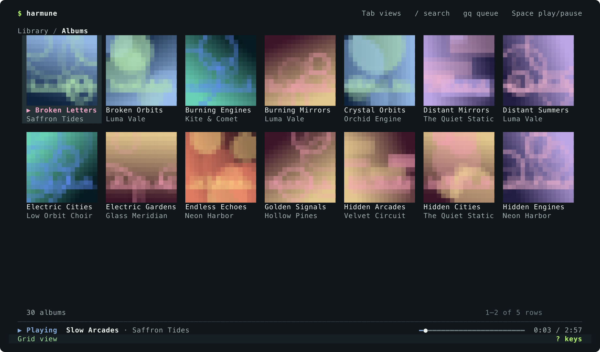

# Harmune

Your music. Your terminal. A keyboard-first Apple Music player for macOS.



## Requirements

- macOS 15 or later
- An Apple Music subscription, for real playback
- To build from source: a Swift 6 toolchain (Xcode 16 or later)
- For release builds: an Apple silicon Mac

The demo needs only the Swift toolchain, with no Apple account or subscription.

## Status

Harmune plays Apple Music from a signed host with Music.app closed, and keeps playing after the terminal closes ([test results](docs/PHASE0_RESULTS.md)). Version 0.1.0 is available as a signed, notarized build through Homebrew or [GitHub Releases](https://github.com/rociiu/harmune/releases).

**What's in it**

- **TUI:** Home, Search, Songs, Albums (artwork grid or list), Artists, Playlists, Recently Played, album, artist and playlist pages, Queue, immersive Now Playing, Settings, help and command mode
- **Themes:** harmune-midnight, tokyo-night, catppuccin-mocha, gruvbox-dark, nord, dracula, mono, and your own
- **Artwork:** Kitty graphics (Kitty, Ghostty), iTerm2 inline images (iTerm2, WezTerm), Sixel, or half-blocks everywhere else. Kitty-compatible terminals also show a soft cover-derived background in immersive Now Playing when artwork and dynamic colors are enabled
- **CLI:** playback, queue, search, library, service, config, key list, shell completions and cache

**Known limitations**

- Press `gf` to browse favorite songs and albums from your library. Press `f` on a catalog song or album to add it to Apple Music favorites. Remove favorites in Apple Music.
- The visualizer is decorative, because MusicKit doesn't expose audio.
- There's no volume control, because MusicKit has no API for it on macOS.
- Inside tmux, artwork uses half-blocks.
- Kitty, iTerm2 and Sixel image output is tested by its bytes, but hasn't been checked by eye in those terminals yet.

## Install with Homebrew

Homebrew only loads casks from taps you trust, so trust the cask first:

```bash
brew trust --cask rociiu/tap/harmune
```

```bash
brew install --cask rociiu/tap/harmune
```

Homebrew installs `Harmune.app` and links `harmune` into its bin directory. With Homebrew on your `PATH`, the command works as soon as installation finishes. On first launch, grant Apple Music access when prompted.

## Try it

The demo library is fictional, so you don't need an Apple account.

```bash
swift build
```

```bash
.build/debug/harmune --demo
```

Use `↑` and `↓` to move, `Enter` to open or play, and `Space` to pause or resume. Press `Tab` to switch views, `/` to search, `:` to run a command, or `?` for [keyboard shortcuts](docs/KEYBINDINGS.md).

## Use it with Apple Music

Until there's a notarized release, this needs a paid Apple Developer account for signing, as well as an Apple Music subscription. Set up your App ID using [docs/PHASE0_SETUP.md](docs/PHASE0_SETUP.md), then build:

```bash
Scripts/build-host.sh
```

```bash
build/Harmune.app/Contents/Resources/bin/harmune
```

The first run asks you to connect Apple Music. Music keeps playing when you quit, and the host exits after 30 idle minutes. To stop it yourself:

```bash
build/Harmune.app/Contents/Resources/bin/harmune service stop
```

The CLI uses the same host:

```bash
build/Harmune.app/Contents/Resources/bin/harmune search "In Rainbows"
```

```bash
build/Harmune.app/Contents/Resources/bin/harmune play --search "Reckoner"
```

```bash
build/Harmune.app/Contents/Resources/bin/harmune status --json
```

To type just `harmune`, link it from a folder on your `PATH`:

```bash
ln -s "$PWD/build/Harmune.app/Contents/Resources/bin/harmune" ~/.local/bin/harmune
```

Run `harmune --help` for everything else. For shell completions, add this to `~/.zshrc`:

```bash
eval "$(harmune completions zsh)"
```

## Configuration

Harmune reads `~/.config/harmune/config.toml` (or `$XDG_CONFIG_HOME/harmune/config.toml`, or `--config <path>`). A problem in the file never stops the app: it shows a warning and uses the default.

```toml
[general]
theme = "harmune-midnight"   # or tokyo-night, catppuccin-mocha, gruvbox-dark, nord, dracula, mono
start_page = "albums"        # home, search, songs, albums, artists, playlists, queue
restore_last_view = false

[appearance]
show_artwork = true
graphics = "auto"            # auto, kitty, iterm2, sixel, halfblock, none
album_view = "table"         # table or artwork grid
artwork_size = "medium"      # small, medium, large (immersive view)
show_visualizer = true
show_borders = true
dynamic_colors = true        # accent colors from the current cover

[animation]
enabled = true
reduced_motion = false
max_fps = 20

[player]
show_progress = true
show_duration = true

[keys]
sequence_timeout_ms = 600

[keybindings.normal]
"<c-n>" = "next_track"
"s" = "none"                 # unbind
```

Settings (`g,`), the theme picker (`:theme`) and `t` in Albums save their changes here, and leave the rest of the file as you wrote it.

### Custom themes

Add a file such as `~/.config/harmune/themes/my-theme.toml`. Anything you leave out comes from `base`:

```toml
base = "nord"
accent = "#C6A5FF"
background = "#101018"
```

Tokens: `background`, `surface`, `elevated`, `text`, `text_secondary`, `muted`, `accent`, `accent_pink`, `accent_blue`, `success`, `warning`, `error`, `border`.

Check a config file:

```bash
harmune config check
```

## Tests

```bash
swift test
```

## Project docs

- [Architecture](docs/ARCHITECTURE.md)
- [Development and releasing](docs/DEVELOPMENT.md)
- [IPC protocol](docs/PROTOCOL.md)
- [Key bindings](docs/KEYBINDINGS.md)
- [Contributing](CONTRIBUTING.md) and [security reports](SECURITY.md)
- [Original design documents](docs/design/), kept for history

## License

MIT. See [LICENSE](LICENSE).

Harmune is an independent project, and isn't affiliated with or endorsed by Apple. Apple Music is a trademark of Apple Inc.
